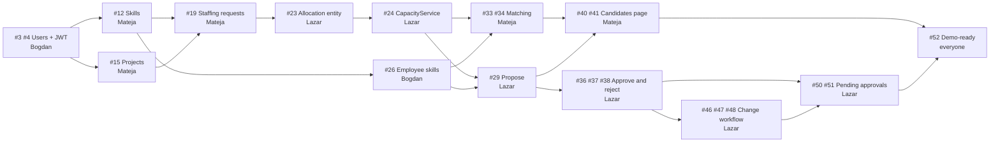

# Sprint 1 backlog: StaffSync

> **Sprint 1** · Mon Oct 19 – Fri Oct 30, 2026 (10 working days) · 3 developers + 1 QA
> **Spec:** [docs/CLAUDE.md](CLAUDE.md) · **Live status:** [sprint issues on GitHub](https://github.com/MatejaJankovic/StaffSync/issues?q=is%3Aissue%20label%3A%22sprint%201%22)
>
> This file is the plan. GitHub Issues hold the live status: every story and task below is an issue, and each task is a sub-issue of its story.

## Contents

- [Sprint goal](#sprint-goal)
- [Team](#team)
- [Key dates and Scrum events](#key-dates-and-scrum-events)
- [What changed from the 3-week plan](#what-changed-from-the-3-week-plan)
- [Priorities and capacity](#priorities-and-capacity)
- [Sprint backlog](#sprint-backlog)
- [Order of work per person](#order-of-work-per-person)
- [Critical path](#critical-path)
- [Flyway migration order](#flyway-migration-order)
- [Working agreements](#working-agreements)
- [Definition of Ready](#definition-of-ready)
- [Definition of Done](#definition-of-done)
- [Product backlog (not in this sprint)](#product-backlog-not-in-this-sprint)
- [Risks](#risks)
- [Open questions](#open-questions)
- [Labels and conventions](#labels-and-conventions)

## Sprint goal

> By **Fri Oct 30**, the full demo scenario from [§4](CLAUDE.md#4-glavni-scenario-demo-tok) runs end to end with `docker compose up --build`. A PM creates a project and a staffing request, gets ranked candidates with score explanations, and proposes them. The RM approves or rejects them with the capacity rule enforced. An approved allocation is changed through RM re-approval. Every endpoint is documented in Swagger.

**Mid-sprint checkpoint (Fri Oct 23):**

- login works for all 4 roles, each with its own menu
- skills, projects and staffing requests are stored and visible in the UI
- `CapacityService` passes the §7 tests
- proposing an allocation works in Swagger
- every endpoint so far is in Swagger

## Team

| Role | Member | Slice | Owns in this sprint |
|---|---|---|---|
| Dev 1 | Bogdan · [@bogdanv4](https://github.com/bogdanv4) | Platform & users | Auth and JWT, Swagger config, error format, shared UI components, users, departments, profile and skills, Home, *My team*, *My allocations*, Docker check |
| Dev 2 | Mateja · [@MatejaJankovic](https://github.com/MatejaJankovic) | Projects & matching | Skills catalog, projects, staffing requests, `MatchingService`, Candidates page, employee search, project status |
| Dev 3 | Lazar · [@lazardunjic](https://github.com/lazardunjic) | Allocations & capacity | `CapacityService`, propose / approve / reject / cancel, change workflow, request status, *Pending approvals*, availability |
| QA | Vukašin · [@patkovicvukasin](https://github.com/patkovicvukasin) | Quality | Test plan and matrix, spec-first unit tests, API tests, E2E, feature-PR testing, test report |

Every developer works full-stack on their slice (backend and frontend) and writes the Swagger annotations for their own endpoints.

## Key dates and Scrum events

| When | Event | What happens |
|---|---|---|
| Mon Oct 19 | **Sprint Planning** | Walk through this backlog, confirm owners and estimates, agree on the API contract (DTOs) and the `CapacityService` interface, and reserve the first Flyway version numbers |
| Every working day, 15 min | **Daily Scrum** (Discord/Teams) | What I finished, what I'm doing next, what's blocking me. Keep issue assignees and linked PRs up to date |
| Fri Oct 23 | **Mid-sprint checkpoint** | Check the checkpoint goal, re-plan the *Should* items, and agree who swarms where |
| Wed Oct 28, end of day | **Feature freeze** | Only merged features make it into the demo. From here on, bug fixes only |
| Thu Oct 29 | Stabilization | Bug fixing, the final demo seed, the full-stack check in Docker, QA regression |
| Fri Oct 30, morning | Demo rehearsal | Run §4 end to end on the demo build |
| Fri Oct 30 | **Sprint Review** and **Retrospective** | Present the demo, then discuss what went well and what to change |

## What changed from the 3-week plan

The proposal planned 3 weeks: the MVP in weeks 1–2, then stretch work and polish in week 3. We now have **2 weeks for the MVP and the polish together**, run as a single sprint.

- **Stretch work is out of the sprint.** Absences, documents and the heatmap are in the [product backlog](#product-backlog-not-in-this-sprint) (label `stretch`). They're pulled in only if the whole MVP is merged before the freeze.
- **The feature freeze moves to Wed Oct 28.** It used to be day 3 of week 3.
- **The full Docker stack already runs** ([PR #1](https://github.com/MatejaJankovic/StaffSync/pull/1)). What's left is the final check on Thu Oct 29.
- **MoSCoW priorities.** Every sprint item is *Must* or *Should*. If the Fri Oct 23 checkpoint shows we're behind, *Should* items are dropped first.
- **Rebalancing.** *My team* (RM) and *My allocations* (Employee) moved from Dev 3 to Dev 1. Dev 3 has the heaviest critical path, and Dev 1's Home cards need the same data anyway.
- **Tasks and bugs live in GitHub Issues** instead of Discord/Teams.

## Priorities and capacity

| Priority | Meaning |
|---|---|
| **Must** | The demo's critical path. Without it there is no demo |
| **Should** | The rest of the MVP. This is the buffer, and the first thing dropped if we fall behind |
| **Could** | Stretch work. Not in this sprint |

Story points (Fibonacci) are relative sizes, not hours:

| Member | Must | Should | Total |
|---|---|---|---|
| Bogdan (Dev 1) | 18 | 19 | 37 |
| Mateja (Dev 2) | 29 | 8 | 37 |
| Lazar (Dev 3) | 34 | 3 | 37 |
| Shared demo story (US-15) | 5 | – | 5 |
| Vukašin (QA) | 21 | – | 21 |
| **Sprint total** | **107** | **30** | **137** |

This is the team's first sprint, so there is no velocity yet. At the checkpoint, compare the *Must* points done with the plan.

**Swarm rule:** Lazar has the most *Must* work. An unblocked *Must* task on the critical path always comes before a *Should* task. Whoever has a free slot checks Lazar's frontend tasks first: [#31][i31], [#44][i44], [#48][i48] and [#51][i51].

## Sprint backlog

Every story lists its tasks. Open a story to see the acceptance criteria, business rules (BR-x), test cases (T-xx) and dependencies.

### Must

| Issue | Story | Owner | SP | Target | Tasks |
|---|---|---|---|---|---|
| [#2][i2] | US-01: Log in and use the app according to my role | Bogdan | 8 | Week 1 | [#3][i3] [#4][i4] [#5][i5] [#6][i6] |
| [#7][i7] | US-02: API foundation: Swagger Authorize, one error format and shared UI components | Bogdan | 5 | Week 1 | [#8][i8] [#9][i9] [#10][i10] |
| [#11][i11] | US-03: Skills catalog | Mateja | 3 | Week 1 | [#12][i12] [#13][i13] |
| [#14][i14] | US-04: PM creates and manages projects | Mateja | 5 | Week 1 | [#15][i15] [#16][i16] [#17][i17] |
| [#18][i18] | US-05: PM creates staffing requests with required skills | Mateja | 8 | Week 1 | [#19][i19] [#20][i20] [#21][i21] |
| [#22][i22] | US-06: Capacity engine: daily load and free capacity | Lazar | 5 | Week 1 | [#23][i23] [#24][i24] |
| [#25][i25] | US-07: Employee maintains profile and skills | Bogdan | 5 | Week 1 | [#26][i26] [#27][i27] |
| [#28][i28] | US-08: PM proposes an employee for a staffing request | Lazar | 5 | Week 1–2 | [#29][i29] [#30][i30] [#31][i31] |
| [#32][i32] | US-09: Matching engine ranks candidates with explanations | Mateja | 8 | Week 1–2 | [#33][i33] [#34][i34] |
| [#35][i35] | US-10: RM approves or rejects proposed allocations | Lazar | 8 | Week 1–2 | [#36][i36] [#37][i37] [#38][i38] |
| [#39][i39] | US-11: PM reviews ranked candidates and proposes one | Mateja | 5 | Week 2 | [#40][i40] [#41][i41] |
| [#42][i42] | US-12: PM withdraws a proposal or cancels an allocation before it starts | Lazar | 3 | Week 2 | [#43][i43] [#44][i44] |
| [#45][i45] | US-13: PM requests a change to an approved allocation | Lazar | 8 | Week 2 | [#46][i46] [#47][i47] [#48][i48] |
| [#49][i49] | US-14: RM sees pending approvals marked New or Change | Lazar | 5 | Week 2 | [#50][i50] [#51][i51] |
| [#52][i52] | US-15: Demo-ready: seed data, full stack in Docker, rehearsed scenario | Bogdan, Mateja, Lazar | 5 | Week 2 | [#53][i53] [#54][i54] [#55][i55] [#56][i56] |

### Should

| Issue | Story | Owner | SP | Target | Tasks |
|---|---|---|---|---|---|
| [#57][i57] | US-16: Availability endpoint and capacity bar | Lazar | 3 | Week 1–2 | [#58][i58] [#59][i59] |
| [#60][i60] | US-17: Admin manages departments | Bogdan | 2 | Week 2 | [#61][i61] [#62][i62] |
| [#63][i63] | US-18: Admin creates and manages user accounts | Bogdan | 5 | Week 2 | [#64][i64] [#65][i65] [#66][i66] |
| [#67][i67] | US-19: User changes own password | Bogdan | 2 | Week 2 | [#68][i68] [#69][i69] |
| [#70][i70] | US-20: Home page with role-specific cards | Bogdan | 5 | Week 2 | [#71][i71] [#72][i72] |
| [#73][i73] | US-21: RM sees my team with current load | Bogdan | 3 | Week 2 | [#74][i74] [#75][i75] |
| [#76][i76] | US-22: Employee sees my allocations | Bogdan | 2 | Week 2 | [#77][i77] |
| [#78][i78] | US-23: PM or RM searches employees by skill and availability | Mateja | 5 | Week 2 | [#79][i79] [#80][i80] |
| [#81][i81] | US-24: PM changes project status, with the BR-11 clean-up | Mateja (and Lazar for [#83][i83]) | 3 | Week 2 | [#82][i82] [#83][i83] [#84][i84] |

### QA (Must)

| Issue | Story | Owner | SP | Target | Tasks |
|---|---|---|---|---|---|
| [#85][i85] | QA-01: Test plan and test matrix | Vukašin | 3 | Week 1 | [#86][i86] [#87][i87] |
| [#88][i88] | QA-02: Spec-first unit tests for CapacityService and MatchingService | Vukašin | 5 | Week 1 | [#89][i89] [#90][i90] |
| [#91][i91] | QA-03: Automated API tests with REST Assured and Testcontainers | Vukašin | 8 | Week 1–2 | [#92][i92] [#93][i93] [#94][i94] [#95][i95] |
| [#96][i96] | QA-04: E2E demo scenario, regression and test report | Vukašin | 5 | Week 2 | [#97][i97] [#98][i98] [#99][i99] |

## Order of work per person

The order follows the dependencies. Days are targets, not deadlines; raise any slip at the Daily Scrum.

### Bogdan (Dev 1)

**Week 1**

1. Mon: [#3][i3] users and departments migration with seeded accounts. Everyone needs this first
2. Mon: [#8][i8] `OpenApiConfig` and the Swagger conventions
3. Mon–Tue: [#9][i9] error format and paging convention
4. Tue: [#4][i4] JWT login and `/api/auth/me`
5. Wed: [#5][i5] login page and interceptor
6. Wed–Thu: [#6][i6] layout, role menu and guards
7. Thu: [#10][i10] error snackbar, `confirm-dialog`, `status-chip`, `paged-table`
8. Thu: [#26][i26] employee skills API
9. Fri: [#27][i27] *My profile*

**Week 2**

1. Mon: [#53][i53] demo seed: users and employee skills. Mateja and Lazar build on it
2. Mon: [#61][i61] [#62][i62] departments
3. Mon–Tue: [#64][i64] [#65][i65] [#66][i66] user administration
4. Tue: [#68][i68] [#69][i69] change password
5. Tue–Wed: [#71][i71] [#72][i72] Home cards
6. Wed: [#74][i74] [#75][i75] *My team*, and [#77][i77] *My allocations*
7. Thu: [#56][i56] full-stack check in Docker and the README demo guide

From Tue Oct 27, check every day whether [#48][i48] or [#51][i51] can be taken over. They come before your remaining *Should* items.

### Mateja (Dev 2)

**Week 1**

1. Mon: agree on the `CapacityService` interface with Lazar and Vukašin ([#24][i24])
2. Mon–Tue: [#12][i12] skills with ~25 seeded skills
3. Tue: [#15][i15] projects API
4. Wed: [#19][i19] staffing requests API. Merge it early, because Lazar's allocation migration needs the table
5. Wed: [#16][i16] *My projects*
6. Thu: [#17][i17] *Project details*
7. Thu: [#20][i20] request form with `skill-level-picker` and `date-range-picker`. Merge the pickers early, because Bogdan needs `skill-level-picker`
8. Thu–Fri: [#33][i33] `MatchingService` with unit tests, using a mocked `CapacityService`
9. Fri: [#21][i21] requests on *Project details*

**Week 2**

1. Mon: [#34][i34] candidates endpoint, and [#54][i54] demo seed: projects and requests
2. Mon–Tue: [#40][i40] Candidates page
3. Tue: [#41][i41] Propose dialog, and [#13][i13] Skills catalog page
4. Wed: [#79][i79] [#80][i80] employee search
5. Wed: [#82][i82] [#84][i84] project status. Also take [#83][i83] if Lazar is overloaded (see below)

### Lazar (Dev 3)

**Week 1**

1. Mon: agree on the `CapacityService` interface with Mateja and Vukašin
2. Mon–Wed: [#23][i23] allocation entity and migration. Merge it right after [#19][i19]
3. Tue–Wed: [#24][i24] `CapacityService` with unit tests
4. Wed–Thu: [#29][i29] propose
5. Fri: [#30][i30] allocation search, and [#58][i58] availability endpoint
6. Fri → Mon: [#36][i36] approve with the capacity check

**Week 2**

1. Mon: [#37][i37] reject, [#38][i38] request status (BR-10), and [#31][i31] project team panel
2. Mon–Tue: [#55][i55] demo seed: allocations
3. Tue: [#43][i43] [#44][i44] withdraw and cancel, [#46][i46] change request, [#50][i50] pending list, and [#59][i59] `capacity-bar`, which Bogdan needs on Wed
4. Wed: [#47][i47] change decisions, [#48][i48] change dialog, [#51][i51] *Pending approvals* page, and [#83][i83] the allocation side of BR-11

⚠️ **Wed Oct 28 is overloaded for Lazar.** Plan the swarm at the checkpoint: [#51][i51] goes to the first free developer, and [#83][i83] can move to Mateja, since it belongs to Mateja's story US-24.

### Vukašin (QA)

**Week 1**

1. Mon: [#86][i86] test plan
2. Tue: [#87][i87] test matrix and authorization matrix
3. Tue–Wed: [#89][i89] `CapacityService` tests, written before the implementation
4. Wed–Thu: [#90][i90] `MatchingService` tests, written before the implementation
5. Wed–Thu: [#92][i92] API test base
6. Fri → Tue: [#93][i93] authorization matrix tests
7. Fri → Mon: [#97][i97] Playwright setup

**Week 2**

1. Mon–Tue: [#94][i94] allocation rules API tests
2. Wed: [#95][i95] change workflow API tests
3. Tue–Thu: [#98][i98] E2E of the §4 scenario
4. Wed–Fri: [#99][i99] regression (Wed and Thu) and the test report (Fri)

**All sprint:** test and approve feature PRs within half a working day.

## Critical path

The demo depends on this chain. A delay anywhere on it delays the demo, so these tasks go first and get help first.

## Flyway migration order

Tables reference each other, so the migrations must be applied in this order. Reserve the next version number on the channel just before opening the PR ([§12](CLAUDE.md#12-tehnologije-arhitektura-i-docker)).

| Order | Tables | Task |
|---|---|---|
| 1 | `department`, `users` (plus the seeded admin and one user per role) | [#3][i3] |
| 2 | `skill` (plus ~25 skills) | [#12][i12] |
| 3 | `employee_skill` | [#26][i26] |
| 4 | `project` | [#15][i15] |
| 5 | `staffing_request`, `request_skill` | [#19][i19] |
| 6 | `allocation` | [#23][i23] |
| 7 | Demo seeds: users and skills → projects and requests → allocations | [#53][i53] → [#54][i54] → [#55][i55] |

- Never edit a migration after it's merged. Every change is a new migration.
- If your local database complains after a pull (for example, a lower version merged after a higher one), reset it with `docker compose down -v`. The seed migrations bring everything back.

## Working agreements

- **Picking work:** take the next task in your order of work above. It's already assigned to you. Mention any swap at the Daily Scrum.
- **Branches:** `feature/<issue-number>-<short-description>`, e.g. `feature/4-jwt-login`.
- **One task = one small PR:** one endpoint or one screen. The PR body says `Closes #<task>`, lists the BR-x rules, and explains how to test it. The PR template asks for all of this.
- **Before opening a PR,** run the local checks, since there is no CI: `mvn verify` for the backend, and `ng build` and `ng test` for the frontend.
- **Reviews:** every PR needs 1 developer approval, and feature PRs also need QA approval. QA reviews within half a working day. If QA can't make it, merge with the developer's approval, and QA tests it on `main` afterwards.
- **API first:** publish your DTOs and endpoints in Swagger early, even as stubs, so frontend work and QA's API tests can start. The frontend can use mock data until the endpoint merges.
- **Interfaces between slices:** agree on these before coding:
  - `CapacityService`: Lazar with Mateja and Vukašin, on day 1
  - the team panel component input: Lazar with Mateja
  - `skill-level-picker`: built by Mateja, used by Bogdan
  - `capacity-bar`: built by Lazar, used by Bogdan
- **Must before Should:** an unblocked *Must* task on the critical path always comes before a *Should* task (see the swarm rule).
- **Bugs:** open an issue with the *Bug* template, link the story, assign the story owner and set the severity. Demo blockers come first.
- **Closing:** a task closes when its PR merges. A story closes when all its tasks are closed and QA has verified its acceptance criteria.
- **Status:** keep issues current, with the right assignee and a linked PR. Optionally, add a GitHub Project board (Todo / In progress / In review / Done) for `label:"sprint 1"`.

## Definition of Ready

A story is ready to start when:

- it has a user story and testable acceptance criteria
- it names the business rules (BR-x) and test cases (T-xx) it covers
- its dependencies are known and linked
- the API contract (endpoint and DTO) is agreed and visible in Swagger, at least as a stub
- it is estimated and has an owner

Every story in this sprint met this at Sprint Planning. Settle the [open questions](#open-questions) before starting the task that depends on them.

## Definition of Done

Taken from [§15](CLAUDE.md#15-definition-of-done). A task is done when:

- [ ] the code is reviewed and approved by at least one other developer
- [ ] input is validated (Bean Validation), and errors use the standard format
- [ ] every new endpoint has Swagger annotations (`@Tag`, `@Operation`, `@ApiResponse`) and works from Swagger UI
- [ ] schema changes are a new Flyway migration
- [ ] `mvn verify`, and `ng build` and `ng test`, pass locally
- [ ] it works with `docker compose up --build`
- [ ] for a feature PR, QA has tested the branch and approved the PR. If it was merged without QA because of the deadline, QA has tested it on `main`

A story is done when all its tasks are done and QA has verified its acceptance criteria.

## Product backlog (not in this sprint)

These stretch stories are unassigned. They're pulled into the sprint only if the whole MVP is merged before the feature freeze (Wed Oct 28), and they get broken into tasks at that point.

| Issue | Story | Proposed owner | Notes |
|---|---|---|---|
| [#100][i100] | US-25: Employees report absences and RMs approve them | Lazar | Stretch #1 · BR-14, T-07 |
| [#101][i101] | US-26: Upload a CV and project documents | Bogdan | Stretch #2 · T-28 |
| [#102][i102] | US-27: RM sees a weekly team timeline / heatmap | Mateja | Stretch #3 |

Deliberately out of scope ([§17](CLAUDE.md#17-mvp-stretch-i-van-opsega)): notifications, self-registration, refresh tokens, CI/CD and cloud deployment, analytics and charts, an audit log, and microservices.

## Risks

| Risk | Mitigation |
|---|---|
| The MVP was planned for 3 weeks | MoSCoW priorities, the checkpoint on Fri Oct 23, dropping *Should* items first, no stretch work, and the feature freeze on Wed Oct 28 |
| Dev 3 is on the critical path (capacity → approve → change → pending approvals) | QA's spec-first tests for `CapacityService`, the swarm rule, moving [#83][i83] to Mateja, and giving [#51][i51] to the first free developer |
| Interfaces between slices (`CapacityService` ↔ matching, allocations ↔ requests, shared components) | Agree on interfaces on day 1, mock them in unit tests, and merge entity migrations early ([#19][i19] before [#23][i23]) |
| Flyway version conflicts | Reserve numbers on the channel, follow the migration order above, and reset with `docker compose down -v` |
| Frontend and backend integrate late | API first in Swagger, with the frontend mocking until the endpoint merges |
| QA becomes a bottleneck | Half-day turnaround, small PRs, and merging with the developer's approval when QA can't make it in time (then tested on `main`) |
| The demo data doesn't produce the §4 numbers | The seed tasks ([#53][i53]–[#55][i55]) spell out the personas exactly, and QA's E2E test ([#98][i98]) checks Marko at 85 and Jelena at 67 |
| `main` breaks without CI | `mvn verify`, `ng build` and `ng test` before every PR, plus QA regression on Wed and Thu |

## Open questions

Settle each one before starting the task that depends on it, and write the answer into that issue.

| Question | Issues | Suggestion |
|---|---|---|
| After a 409 on approving a **change**, does the allocation stay `CHANGE_PENDING` or go back to `APPROVED`? T-30 says it "stays APPROVED", but BR-15 returns it to APPROVED only after a decision | [#45][i45], [#47][i47], [#95][i95] | Decide with QA. The old values stay in force either way |
| What happens to allocations when a request is cancelled? | [#18][i18] | Cancel its `PROPOSED` allocations, and only allow cancelling a request that has no active allocations |
| Can a skill or a department that is in use be deleted? | [#12][i12], [#61][i61] | No: return 409 |
| Employee search: must free capacity be ≥ `minFreePercent` on every working day, or on average? | [#78][i78] | On every working day |
| BR-11: what about an approved allocation that hasn't started when its project closes? | [#83][i83] | Cancel it |

**Spec notes** (already written into the issues):

- The first §7 capacity example assumes absences are skipped. Absences are stretch work, so without them the overloaded days are **Nov 10–13 and Nov 16–20**.
- The §8 scores add up when each component is rounded first: 23 + 34 + 10 = 67 (the exact values are 23.33, 33.85 and 10).
- §4 step 7 has no "edit proposal" endpoint. It works as a withdraw ([#43][i43]) followed by a new proposal for Nov 15 – Jan 31.
- jjwt needs an HMAC key of at least 256 bits, so the default `JWT_SECRET=change-me` has to change ([#4][i4]).

## Labels and conventions

| Label | Meaning |
|---|---|
| `user story` | A story (a parent issue, including the QA stories) |
| `task` | A task (a sub-issue of a story) |
| `bug` | A defect, reported with the *Bug* template |
| `sprint 1` | Part of this sprint |
| `stretch` | In the product backlog, not in this sprint |
| `priority: must` · `priority: should` · `priority: could` | MoSCoW priority |
| `backend` · `frontend` · `devops` · `qa` | Layer |
| `platform & users` · `projects & matching` · `allocations & capacity` · `qa` | Slice (Dev 1 · Dev 2 · Dev 3 · QA) |

GitHub ignores issue types in this repository (they're an organization feature), so the `user story`, `task` and `bug` labels mark the type instead.

Titles:

- stories: `US-xx: …`, and QA stories `QA-xx: …`
- tasks: start with `[BE]`, `[FE]`, `[QA]` or `[DevOps]` and end with the story id, e.g. `(US-05)`

Create new issues from the templates in `.github/ISSUE_TEMPLATE/`.

Useful filters:

- My open tasks: [`is:open label:task assignee:@me`](https://github.com/MatejaJankovic/StaffSync/issues?q=is%3Aopen%20label%3Atask%20assignee%3A%40me)
- Sprint stories: [`is:open label:"user story" label:"sprint 1"`](https://github.com/MatejaJankovic/StaffSync/issues?q=is%3Aopen%20label%3A%22user%20story%22%20label%3A%22sprint%201%22)
- *Must* work left: [`is:open label:"priority: must"`](https://github.com/MatejaJankovic/StaffSync/issues?q=is%3Aopen%20label%3A%22priority%3A%20must%22)

<!-- Issue link definitions (generated) -->
[i2]: https://github.com/MatejaJankovic/StaffSync/issues/2
[i3]: https://github.com/MatejaJankovic/StaffSync/issues/3
[i4]: https://github.com/MatejaJankovic/StaffSync/issues/4
[i5]: https://github.com/MatejaJankovic/StaffSync/issues/5
[i6]: https://github.com/MatejaJankovic/StaffSync/issues/6
[i7]: https://github.com/MatejaJankovic/StaffSync/issues/7
[i8]: https://github.com/MatejaJankovic/StaffSync/issues/8
[i9]: https://github.com/MatejaJankovic/StaffSync/issues/9
[i10]: https://github.com/MatejaJankovic/StaffSync/issues/10
[i11]: https://github.com/MatejaJankovic/StaffSync/issues/11
[i12]: https://github.com/MatejaJankovic/StaffSync/issues/12
[i13]: https://github.com/MatejaJankovic/StaffSync/issues/13
[i14]: https://github.com/MatejaJankovic/StaffSync/issues/14
[i15]: https://github.com/MatejaJankovic/StaffSync/issues/15
[i16]: https://github.com/MatejaJankovic/StaffSync/issues/16
[i17]: https://github.com/MatejaJankovic/StaffSync/issues/17
[i18]: https://github.com/MatejaJankovic/StaffSync/issues/18
[i19]: https://github.com/MatejaJankovic/StaffSync/issues/19
[i20]: https://github.com/MatejaJankovic/StaffSync/issues/20
[i21]: https://github.com/MatejaJankovic/StaffSync/issues/21
[i22]: https://github.com/MatejaJankovic/StaffSync/issues/22
[i23]: https://github.com/MatejaJankovic/StaffSync/issues/23
[i24]: https://github.com/MatejaJankovic/StaffSync/issues/24
[i25]: https://github.com/MatejaJankovic/StaffSync/issues/25
[i26]: https://github.com/MatejaJankovic/StaffSync/issues/26
[i27]: https://github.com/MatejaJankovic/StaffSync/issues/27
[i28]: https://github.com/MatejaJankovic/StaffSync/issues/28
[i29]: https://github.com/MatejaJankovic/StaffSync/issues/29
[i30]: https://github.com/MatejaJankovic/StaffSync/issues/30
[i31]: https://github.com/MatejaJankovic/StaffSync/issues/31
[i32]: https://github.com/MatejaJankovic/StaffSync/issues/32
[i33]: https://github.com/MatejaJankovic/StaffSync/issues/33
[i34]: https://github.com/MatejaJankovic/StaffSync/issues/34
[i35]: https://github.com/MatejaJankovic/StaffSync/issues/35
[i36]: https://github.com/MatejaJankovic/StaffSync/issues/36
[i37]: https://github.com/MatejaJankovic/StaffSync/issues/37
[i38]: https://github.com/MatejaJankovic/StaffSync/issues/38
[i39]: https://github.com/MatejaJankovic/StaffSync/issues/39
[i40]: https://github.com/MatejaJankovic/StaffSync/issues/40
[i41]: https://github.com/MatejaJankovic/StaffSync/issues/41
[i42]: https://github.com/MatejaJankovic/StaffSync/issues/42
[i43]: https://github.com/MatejaJankovic/StaffSync/issues/43
[i44]: https://github.com/MatejaJankovic/StaffSync/issues/44
[i45]: https://github.com/MatejaJankovic/StaffSync/issues/45
[i46]: https://github.com/MatejaJankovic/StaffSync/issues/46
[i47]: https://github.com/MatejaJankovic/StaffSync/issues/47
[i48]: https://github.com/MatejaJankovic/StaffSync/issues/48
[i49]: https://github.com/MatejaJankovic/StaffSync/issues/49
[i50]: https://github.com/MatejaJankovic/StaffSync/issues/50
[i51]: https://github.com/MatejaJankovic/StaffSync/issues/51
[i52]: https://github.com/MatejaJankovic/StaffSync/issues/52
[i53]: https://github.com/MatejaJankovic/StaffSync/issues/53
[i54]: https://github.com/MatejaJankovic/StaffSync/issues/54
[i55]: https://github.com/MatejaJankovic/StaffSync/issues/55
[i56]: https://github.com/MatejaJankovic/StaffSync/issues/56
[i57]: https://github.com/MatejaJankovic/StaffSync/issues/57
[i58]: https://github.com/MatejaJankovic/StaffSync/issues/58
[i59]: https://github.com/MatejaJankovic/StaffSync/issues/59
[i60]: https://github.com/MatejaJankovic/StaffSync/issues/60
[i61]: https://github.com/MatejaJankovic/StaffSync/issues/61
[i62]: https://github.com/MatejaJankovic/StaffSync/issues/62
[i63]: https://github.com/MatejaJankovic/StaffSync/issues/63
[i64]: https://github.com/MatejaJankovic/StaffSync/issues/64
[i65]: https://github.com/MatejaJankovic/StaffSync/issues/65
[i66]: https://github.com/MatejaJankovic/StaffSync/issues/66
[i67]: https://github.com/MatejaJankovic/StaffSync/issues/67
[i68]: https://github.com/MatejaJankovic/StaffSync/issues/68
[i69]: https://github.com/MatejaJankovic/StaffSync/issues/69
[i70]: https://github.com/MatejaJankovic/StaffSync/issues/70
[i71]: https://github.com/MatejaJankovic/StaffSync/issues/71
[i72]: https://github.com/MatejaJankovic/StaffSync/issues/72
[i73]: https://github.com/MatejaJankovic/StaffSync/issues/73
[i74]: https://github.com/MatejaJankovic/StaffSync/issues/74
[i75]: https://github.com/MatejaJankovic/StaffSync/issues/75
[i76]: https://github.com/MatejaJankovic/StaffSync/issues/76
[i77]: https://github.com/MatejaJankovic/StaffSync/issues/77
[i78]: https://github.com/MatejaJankovic/StaffSync/issues/78
[i79]: https://github.com/MatejaJankovic/StaffSync/issues/79
[i80]: https://github.com/MatejaJankovic/StaffSync/issues/80
[i81]: https://github.com/MatejaJankovic/StaffSync/issues/81
[i82]: https://github.com/MatejaJankovic/StaffSync/issues/82
[i83]: https://github.com/MatejaJankovic/StaffSync/issues/83
[i84]: https://github.com/MatejaJankovic/StaffSync/issues/84
[i85]: https://github.com/MatejaJankovic/StaffSync/issues/85
[i86]: https://github.com/MatejaJankovic/StaffSync/issues/86
[i87]: https://github.com/MatejaJankovic/StaffSync/issues/87
[i88]: https://github.com/MatejaJankovic/StaffSync/issues/88
[i89]: https://github.com/MatejaJankovic/StaffSync/issues/89
[i90]: https://github.com/MatejaJankovic/StaffSync/issues/90
[i91]: https://github.com/MatejaJankovic/StaffSync/issues/91
[i92]: https://github.com/MatejaJankovic/StaffSync/issues/92
[i93]: https://github.com/MatejaJankovic/StaffSync/issues/93
[i94]: https://github.com/MatejaJankovic/StaffSync/issues/94
[i95]: https://github.com/MatejaJankovic/StaffSync/issues/95
[i96]: https://github.com/MatejaJankovic/StaffSync/issues/96
[i97]: https://github.com/MatejaJankovic/StaffSync/issues/97
[i98]: https://github.com/MatejaJankovic/StaffSync/issues/98
[i99]: https://github.com/MatejaJankovic/StaffSync/issues/99
[i100]: https://github.com/MatejaJankovic/StaffSync/issues/100
[i101]: https://github.com/MatejaJankovic/StaffSync/issues/101
[i102]: https://github.com/MatejaJankovic/StaffSync/issues/102
